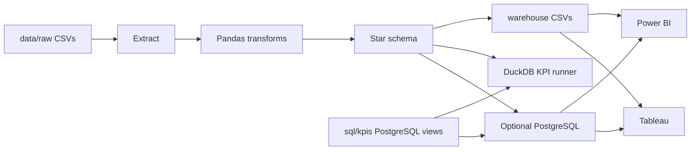

# data-bi-analytics-suite

End-to-end retail analytics for a fictional home-goods retailer, **Lumen & Field** (DACH and Benelux). Raw order extracts are cleaned with Pandas, conformed to a star schema, and scored with PostgreSQL-compatible KPI views. The same SQL runs locally on DuckDB, so the project tests offline. Power BI and Tableau connect to the CSV warehouse or to an optional PostgreSQL load.

Amounts in the sample are EUR. Every customer, order, and email is synthetic.

## Quick start

```bash
python -m pip install -e ".[dev]"
bi-analytics run
pytest
```

`bi-analytics run` reads `data/raw`, writes `warehouse/`, and prints the executive totals. On the committed sample:

```text
fact_sales: 753
rejected_rows: 51
as_of_date: 2025-06-30
net_revenue: 71708.97
margin_amount: 30390.97
margin_pct: 0.4238
completed_orders: 355
return_rate: 0.0707
```

No API keys, warehouse server, or cloud account are required for that path.

## Architecture



The pipeline refuses to publish KPIs when the SQL views disagree with the Pandas reference.

## Star schema

`fact_sales` is one accepted order line. Dimensions:

| Table | Role |
| :--- | :--- |
| `dim_date` | Calendar day, including days with no sales |
| `dim_customer` | Customer, segment, country |
| `dim_product` | SKU, category, unit cost |
| `dim_store` | Store, region, format |
| `dim_promotion` | Promo code, plus `NONE` for orders without one |
| `fact_sales.channel` | Degenerate dimension: `Web` or `Store` |

Cancelled orders never reach the fact. A returned order stays, with `net_amount` and `cost_amount` set to 0 and the original ticket stored in `return_amount`. That models a full return of resalable goods. Partial returns, tax, shipping, and damaged stock are out of scope.

Surrogate keys are stable for a given input: natural keys are sorted, and `NONE` is always `promotion_key` 1. The date key is `YYYYMMDD`.

Column-level definitions, reject reasons, and the grain are in [docs/data-model.md](docs/data-model.md).

## KPIs

Each view lives in `sql/kpis/` and is also calculated in `bi_analytics.kpis`.

| View | Question it answers |
| :--- | :--- |
| `vw_kpi_executive_summary` | One row: revenue, margin, orders, return rate, AOV, active customers |
| `vw_kpi_monthly_sales` | Dense months from the first order date through the last |
| `vw_kpi_product_performance` | Product revenue, margin, units, and `RANK()` |
| `vw_kpi_store_performance` | Store revenue, margin, completed orders, AOV |
| `vw_kpi_customer_value` | Completed-order value and recency in days |
| `vw_kpi_category_mix` | Category share of net revenue |
| `vw_kpi_channel_comparison` | Web versus store |

Definitions used by both engines:

- **Net revenue** is the sum of `net_amount`. Returned lines contribute 0.
- **Margin %** is margin divided by net revenue. It is null when net revenue is 0.
- **Units sold** ignore returned lines.
- **Completed / returned orders** are distinct `order_id` values.
- **Return rate** is returned orders divided by completed plus returned orders.
- **Average order value** is net revenue divided by completed orders.
- **Recency** is days from the latest calendar day to the customer's last completed order. The SQL uses integer `day_index` values so it does not depend on engine-specific date subtraction.
- **Revenue rank** is SQL `RANK()` (ties share a place, and the next rank skips).

On this sample, Lighting is the largest category (27.96% of net revenue) and store orders outrun web orders (€44,268.09 versus €27,440.88) at almost the same AOV.

## Project layout

```text
src/bi_analytics/     Pipeline package and the bi-analytics CLI
sql/ddl/              PostgreSQL star-schema DDL
sql/kpis/             PostgreSQL KPI views
data/raw/             Synthetic source extracts, including dirty rows
docs/                 Data model, runbook, Power BI, Tableau, security
tests/                Offline pytest suite
scripts/generate_sample_data.py
```

`warehouse/` is generated and gitignored.

## CLI

```bash
bi-analytics run
bi-analytics run --input data/raw --output warehouse --sql-dir sql
bi-analytics run --skip-sql          # Pandas KPIs only
bi-analytics run --postgres          # also load DATABASE_URL
python -m bi_analytics run
```

Settings come from flags, then environment variables, then an optional `.env` file. See [.env.example](.env.example).

| Variable | Default | Purpose |
| :--- | :--- | :--- |
| `INPUT_DIR` | `data/raw` | Raw CSV directory |
| `OUTPUT_DIR` | `warehouse` | Star schema, KPIs, quality report |
| `SQL_DIR` | `sql` | DDL and KPI scripts |
| `DATABASE_URL` | empty | PostgreSQL URL for `--postgres` |
| `LOG_LEVEL` | `INFO` | `DEBUG`, `INFO`, `WARNING`, or `ERROR` |

Outputs:

- `warehouse/dim_*.csv`, `warehouse/fact_sales.csv`
- `warehouse/rejects.csv`
- `warehouse/kpis/*.csv`
- `warehouse/quality_report.json`

## Tests

```bash
pytest
```

The suite covers conformed dimensions, money rounding, quarantine rules, hand-checked KPI figures, parity between Pandas and the SQL views on both the fixture and the full sample, the CLI, and a PostgreSQL parse of every KPI script (`sqlglot`). DuckDB executes the scripts in-process. Nothing in the default test run opens a network connection or a database server.

Regenerate the sample with the same numbers:

```bash
python scripts/generate_sample_data.py
```

The generator uses `random.Random(42)`.

## Docker

Optional. This path needs the `postgres` extra, which the image installs.

```bash
docker compose up --build
```

PostgreSQL 16 listens on `localhost:5432` (`bi` / `bi`, database `bi_analytics`). The `analytics` service runs `bi-analytics run --postgres` and exits after the load. Those credentials are for a local demo only. See [docs/runbook.md](docs/runbook.md) and [docs/security.md](docs/security.md).

## BI handoff

- [Power BI](docs/power-bi.md): relationships, DAX measures that match the SQL, and a four-page report outline
- [Tableau](docs/tableau.md): relationships and calculated fields for the same KPIs
- [Runbook](docs/runbook.md): install, refresh, and failure modes
- [Security notes](docs/security.md): what this batch tool does not protect

## Modeling limits

- Promotion start and end dates are descriptive. The transform does not reject an order outside the window.
- `is_active` on a product does not drop historical sales.
- Dimensions are a current snapshot. There is no slowly changing dimension history.
- The fact date is the order date. There is no shipment or invoice date.
- One currency, no tax, no shipping.

## License

MIT. See [LICENSE](LICENSE).
