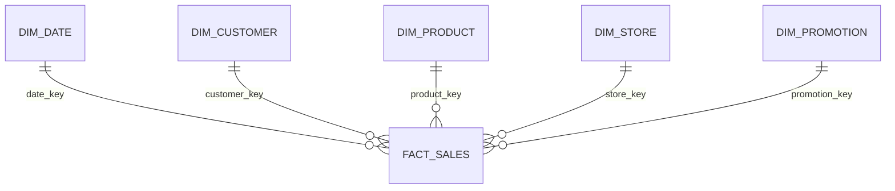

# Data model

Lumen & Field is a fictional home-goods retailer with stores in Germany, Austria, and the Netherlands, plus a web channel. The warehouse is a star schema. Amounts are EUR.

## Grain

`fact_sales` contains one row per accepted order line.

An order is accepted when all of the following hold:

- `order_datetime` parses
- status is `completed` or `returned` (`canceled` is accepted as `cancelled`)
- channel is `Web` or `Store` (`online` maps to `Web`, `retail` maps to `Store`)
- `customer_id` and `store_id` exist after cleaning
- a non-blank `promo_code` exists on `dim_promotion` (a blank code becomes `NONE`)

A line on an accepted order is accepted when:

- `order_line_id` is the first occurrence of that id
- `sku` exists
- quantity is an integer greater than or equal to 1
- unit price is greater than or equal to 0
- discount rate is between 0 and 1 inclusive

Everything else is written to `rejects.csv` and is absent from the fact. Header failures (`cancelled_order`, `unknown_customer`, and the rest) are stamped on every line of that order, and line-level checks are not also applied.

## Money

All money is quantized to cents with half-up rounding, then stored as decimal text (`NUMERIC(18,2)` in PostgreSQL).

For a kept line:

- `gross_amount = quantity * unit_price`
- `discount_amount = gross_amount * discount_pct`
- extended net = `gross_amount - discount_amount`
- if the order is completed: `net_amount` is the extended net, `cost_amount = quantity * unit_cost`, `return_amount = 0`
- if the order is returned: `net_amount = 0`, `cost_amount = 0`, `return_amount` is the extended net
- `margin_amount = net_amount - cost_amount`

Returned lines keep the original gross amount so a report can still see the ticket that was reversed. The model assumes the goods come back in sellable condition. It does not split a partially returned order, and it does not book a loss for damage.

## Dimensions

### dim_date

Built from the earliest accepted order date through the latest, one row per day, including days with no sales. Monthly KPIs are therefore dense inside that span and empty outside it.

| Column | Meaning |
| :--- | :--- |
| `date_key` | `YYYYMMDD` integer, primary key |
| `full_date` | ISO date |
| `year`, `quarter`, `month`, `month_name` | Calendar attributes |
| `day_of_month`, `day_name`, `iso_week`, `is_weekend` | Calendar attributes |
| `day_index` | Days since 2000-01-01, used for recency |

### dim_customer

| Column | Meaning |
| :--- | :--- |
| `customer_key` | Surrogate, assigned after sorting `customer_id` |
| `customer_id` | Natural key |
| `full_name` | Trimmed, each word capitalized |
| `email` | Lowercased. Blank emails are kept |
| `segment` | `Consumer`, `Professional`, `Trade`, or `Unknown` |
| `city`, `country` | Country aliases such as `de`, `Holland`, and `Österreich` map to Germany, Netherlands, and Austria |
| `signup_date` | Optional |

Duplicate `customer_id` values keep the first row.

### dim_product

| Column | Meaning |
| :--- | :--- |
| `product_key` | Surrogate |
| `sku` | Uppercased natural key |
| `product_name`, `category`, `subcategory`, `brand` | Category and subcategory are title-cased |
| `unit_cost` | EUR, must be greater than or equal to 0 |
| `is_active` | Informational. Inactive products can still have sales |

### dim_store

| Column | Meaning |
| :--- | :--- |
| `store_key` | Surrogate |
| `store_id` | Uppercased natural key |
| `store_name`, `city`, `country` | Country uses the same alias map as customers |
| `region` | Uppercased code, `DACH` or `BENELUX` in the sample |
| `store_format` | `Flagship`, `Outlet`, `Web`, or `Unknown` |

### dim_promotion

| Column | Meaning |
| :--- | :--- |
| `promotion_key` | `1` is always `NONE` / "No Promotion" |
| `promo_code` | Uppercased. Blank source codes become `NONE` |
| `promo_name` | Display name |
| `start_date`, `end_date` | Descriptive only. The load does not enforce them |

### fact_sales

| Column | Meaning |
| :--- | :--- |
| `sales_key` | Surrogate, ordered by order date, order id, line id |
| `order_line_id`, `order_id` | Degenerate identifiers. `order_line_id` is unique |
| `date_key`, `customer_key`, `product_key`, `store_key`, `promotion_key` | Foreign keys |
| `channel` | `Web` or `Store` |
| `quantity`, `unit_price`, `discount_pct` | Line inputs after validation |
| `gross_amount`, `discount_amount`, `net_amount`, `cost_amount`, `margin_amount`, `return_amount` | EUR measures |
| `is_returned` | True when the order status is returned |

PostgreSQL DDL, including foreign keys and check constraints, is `sql/ddl/01_star_schema.sql`.

## Reject reasons

| Reason | Typical cause |
| :--- | :--- |
| `duplicate_customer`, `duplicate_sku`, `duplicate_store`, `duplicate_promotion`, `duplicate_order`, `duplicate_line` | Repeated natural key. The first row is kept |
| `unknown_country` | Country text outside the alias map |
| `invalid_unit_cost`, `missing_sku` | Product cannot be used |
| `invalid_order_datetime`, `invalid_status`, `invalid_channel` | Header cannot be interpreted |
| `cancelled_order` | Status cancelled. Lines are excluded |
| `unknown_customer`, `unknown_store`, `unknown_promotion` | Header points at a missing dimension member |
| `missing_order` | Line whose order id is not in the order file |
| `unknown_sku`, `invalid_quantity`, `invalid_price`, `invalid_discount` | Line failed validation |
| `missing_customer_id`, `missing_order_id`, `missing_line_id`, `missing_store_id`, `missing_promo_code` | Blank required identifier |

`warehouse/quality_report.json` counts these reasons and checks that every fact foreign key exists. The pipeline raises if a foreign-key check fails.

## Sample shape

The committed extract is produced by `scripts/generate_sample_data.py` with seed 42. It covers 2024-01-01 through 2025-06-30 and deliberately includes a duplicated customer, aliased countries, a cancelled order, unknown keys, a bad quantity, a bad price, a bad discount, an orphan line, and a duplicated line id. Those rows are how the quarantine path is demonstrated. They are not production defects to "fix" in the CSV.
